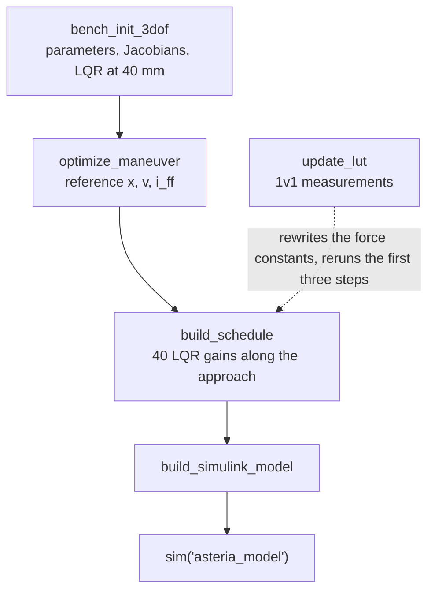
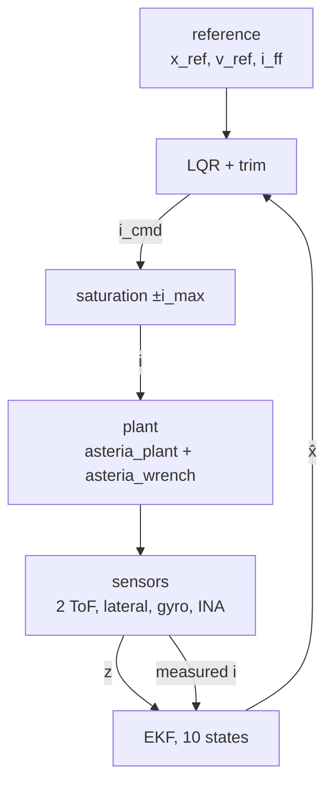

# ASTERIA GNC — onboarding guide

A guided path through the GNC design and code for new team members. It is meant to be read top to bottom with MATLAB open at the repository root. Each part ends with a short exercise; answers are at the end. About two days of work.

Companion documents: `RUNBOOK.md` (operating the bench, tuning, performance), `CALIBRATION.md` (1v1 calibration procedure), `ICD.md` (what the electronics must deliver), `BOM_INPUT.md` (components and test equipment), `TOOLCHAIN.md` (replay and identification), `OPEN_POINTS.md` (open work and timeline).

## Part 0. Set up

```matlab
startup          % from the repository root: sets the path
run_all_tests    % a few minutes
```

Expected: `plant`, `replay`, `precision`, `sil`, `simulink` give **pass**. `ekf`, `closed_loop`, `envelope` and `update_lut` give **ran**: they print tables that you read, not a verdict. A **FAIL** or **ERROR** means your installation does not reproduce the reference results. Stop and sort that out before anything else.

The order in which things are built, after any parameter change:



`bench_init_3dof` prints which force model it loaded: "geometry model, UNCALIBRATED" or the name of a calibration file. Read that line every time you run it.

## Part 1. The problem and the architecture

**The bench.** Two docking interfaces, each with four solenoids on a square of ±25 mm. The target is fixed. The chaser floats on the planar air bearing and carries its own coils, sensors and flight computer. The job: fly the chaser from a 60 mm gap to bare face contact, arriving at −20 ± 10 mm/s. There is no capture mechanism, and $x = 0$ means the two faces touch.

**Degrees of freedom.** The air bearing leaves three: gap $x$, lateral offset $y$, yaw $\theta$. The state of the rigid body is $[x\ y\ \theta\ v_x\ v_y\ \omega]$.

**What we actually control: two of them.** Write the linearised wrench (force and torque) as $\delta\mathbf W = K_\text{pose}\,\delta\boldsymbol\xi + B_i\,\delta\mathbf i$. Here $\delta$ marks a small change, $\boldsymbol\xi = [x\ y\ \theta]^\mathsf T$ is the pose and $\mathbf i$ the four chaser coil currents. $K_\text{pose}$ is the stiffness matrix and $B_i$ the control effectiveness, force and torque per amp of each coil; Part 3 derives both. At 40 mm the four columns of $B_i$ are, row by row (axial force $F_x$, lateral force $F_y$, yaw torque $M_z$, per amp):

| | coil 1 (+y) | coil 2 (+y) | coil 3 (−y) | coil 4 (−y) |
| --- | --- | --- | --- | --- |
| Fx [mN/A] | −8.14 | −8.14 | −8.14 | −8.14 |
| Fy [mN/A] | −2.34 | −2.34 | +2.34 | +2.34 |
| Mz [mN·m/A] | +0.257 | +0.257 | −0.257 | −0.257 |

The Fy row is a multiple of the Mz row: any current pattern that pushes sideways also yaws the chaser by a fixed amount. $B_i$ has rank 2. With parallel coil axes (cant = 0), the currents command **axial force and yaw torque**, and lateral force is not independent. This is geometry, not a modelling shortcut. Lateral control needs canted coils, which is a later, system-level decision. For now lateral motion is left alone and monitored.

**Why it needs feedback at all: Earnshaw's theorem.**

*What it says.* Earnshaw (1842): a body acted on only by static sources (fixed charges, permanent magnets, coils at fixed current) cannot rest in a stable equilibrium. Every equilibrium is a saddle, with at least one unstable direction. Braunbek (1939) showed that iron and other ferromagnetic or paramagnetic materials do not change this; only diamagnets and superconductors escape it.

*Why.* With fixed sources the force on the chaser comes from a potential energy, $\mathbf F = -\nabla U$. Here $U$ is the chaser's magnetic potential energy [J] as a function of its position, and $\nabla$ is the gradient. In the empty space between the coils, $U$ satisfies Laplace's equation:

$$\nabla^2 U = \frac{\partial^2 U}{\partial x^2} + \frac{\partial^2 U}{\partial y^2} + \frac{\partial^2 U}{\partial z^2} = 0$$

- $\nabla^2$: the Laplacian, the sum of the three curvatures of $U$. $z$: the vertical direction.
- A stable equilibrium is a minimum of $U$, which needs all three curvatures positive. Three positive numbers cannot sum to zero.
- Equivalent picture: a solution of Laplace's equation equals its own average over any small sphere around a point, so it can never be lower than all its neighbours. The best you can get is a saddle.
- The same holds for the rigid chaser: its energy is a sum over its eight poles, each term satisfies Laplace's equation, so the sum does too.

*In stiffness terms.* With the convention of Part 3, $K_{ii} = \partial F_i/\partial x_i$ (positive = destabilising), the same statement reads

$$K_{xx} + K_{yy} + K_{zz} = -\nabla^2 U = 0$$

- By our symmetry $K_{yy} = K_{zz} = -K_{xx}/2$: stiffen one direction and the others soften.
- At 40 mm and half current, the unsoftened pole model gives $K_{xx} = +0.405$ N/m and $K_{yy} = K_{zz} = -0.203$ N/m, summing to zero within $10^{-9}$.
- The softened model in the code gives +0.388, −0.199, −0.199. The softening does not satisfy Laplace's equation exactly, a known artefact.

*What it means for this bench:*
- Attracting (docking): axial is unstable, lateral and vertical are springs. The air bearing carries the vertical; lateral is the 0.07 Hz spring below.
- Repelling (braking): every sign flips. Axial becomes a spring and lateral becomes unstable (Part 3, braking).
- Yaw is the rotational counterpart: a yawed interface brings one side closer, and that side pulls harder.
- No coil layout fixes this. Geometry only moves the instability between directions.
- The way out is feedback. Earnshaw assumes static sources, and our currents change with the measured state 1000 times a second. That is why this is a control problem at all.
- In orbit there is no air bearing, so more directions are free. The flight GNC inherits the same problem.

The modes at 40 mm with half current:

| Mode | Open-loop eigenvalues | Meaning |
| --- | --- | --- |
| axial | ±0.64 rad/s | attraction grows as the gap closes: positive stiffness, falls in |
| yaw | ±0.41 rad/s | a yawed interface brings one side closer, and that side pulls harder |
| lateral | ±0.46 j rad/s (0.07 Hz) | weak restoring spring, undamped |

If you ever see purely imaginary axial eigenvalues, the stiffness sign is flipped. You are then simulating a spring, and the controller will look as if it works while validating nothing.

**The drive.** The target coils are held at a fixed +0.427 A ($i_\text{max}$). Only the chaser coils are modulated, within ±0.427 A, from two separate current-controlled supplies. Each force term is proportional to $q_\text{target}\,q_\text{chaser}$, so with the target fixed **the force is linear in the chaser current and reverses sign with it**: positive current attracts, negative current repels, and the controller can brake. Driving both sides with the same current, the obvious alternative, gives a force proportional to $i^2$: always attractive, so it cannot brake. That was the earlier design and it is gone.

**The signal flow.**



Everything runs at 1 kHz. The ToF sensors and the lateral sensor update at 30 Hz and the gyro at 500 Hz. The EKF is fed the **measured** current, not the commanded one (Part 4 explains why).

**Exercise 1.** Run `bench_init_3dof` and look at `P.ol_eig6`, `P.des.rank_ctrl`, `P.des.Bi` and `P.mode`. Find the three modes in the table above. Then look at `P.cant.rank` and `P.cant.dFy` from the cant sweep (section 5 of `bench_init_3dof`): what happens to the rank as soon as the cant is non-zero, and how much lateral authority does it buy?

## Part 2. The force model

Every solenoid is modelled as two magnetic poles of strength $\pm q$, one at each core face. Every chaser pole interacts with every target pole (8 × 8 = 64 terms) through a softened inverse-square law:

$$\mathbf{F}_{ab} = \frac{\mu_0\, q_a q_b}{4\pi}\,\frac{\mathbf{r}_{ab}}{\left(|\mathbf{r}_{ab}|^2 + x_0^2\right)^{3/2}}$$

`asteria_wrench` sums these terms into $[F_x\ F_y\ M_z]$, with $M_z$ taken about the chaser interface centre. The pole strength comes from the coil geometry (1289 turns, 3.9 mm iron core, 30 mm long): $q = 25.05$ A·m per amp. The softening length $x_0 = 3.9$ mm keeps the force finite at contact. Never remove it: a pure inverse power blows up the integrator at $x \to 0$.

Two consequences to remember:

- **Force is proportional to $q^2$**, because both sides scale with `P.cal.scale`. A 20% error in $q$ is a 44% error in force.
- **Uncalibrated, the model is a factor-of-two estimate.** The 1v1 calibration (`update_lut` on the T1 force map, see `CALIBRATION.md`) fits $q$ and $x_0$ and brings this to a few percent. The loop needs ±12–15%. Calibration is not optional: uncalibrated, the Monte Carlo pass rate is 44%.

What the model gets right regardless of the constants: the far-field dipole law, linearity in current, the rank-2 structure, and which modes are unstable. What it does not contain: induced magnetisation between the cores (it dominates in the last millimetres), hysteresis, eddy currents, Earth's field (align the docking axis with magnetic north), and coil inductance in the plant.

**Exercise 2.** At 40 mm and full current, compute `asteria_wrench(P,[0.04;0;0],P.i_max*ones(4,1))`. Make a copy with a 10% stronger pole, `P2 = P; P2.coil.q_perA = 1.1*P.coil.q_perA;`, and compute the same wrench with `P2`. Predict the ratio before you compute it. (Do not set `P.cal.scale` by hand before `bench_init_3dof`: the script sets it itself, from the calibration file if there is one.)

## Part 3. The controller

This part goes from the physics to the gain: the nonlinear model, its linearisation, what the linear model says about controllability, the LQR design, and then the reference, including why braking is the hard part. Every symbol is defined where it first appears.

### The nonlinear model

**State, input, disturbance.**

| Symbol | Name | Unit | Meaning |
| --- | --- | --- | --- |
| $x$ | gap | m | distance between the two interface planes along the docking axis; $x = 0$ is face contact, $x > 0$ is apart |
| $y$ | lateral offset | m | sideways offset of the chaser interface centre from the target axis |
| $\theta$ | yaw | rad | rotation of the chaser about the vertical axis; positive moves the +y side towards the target |
| $\boldsymbol\xi = [x\ y\ \theta]^\mathsf T$ | pose | m, m, rad | the three positions together |
| $v_x, v_y, \omega$ | velocities, yaw rate | m/s, m/s, rad/s | $\dot x$, $\dot y$, $\dot\theta$ (a dot is a time derivative) |
| $\mathbf v = [v_x\ v_y\ \omega]^\mathsf T$ | rates | | |
| $\mathbf s = [\boldsymbol\xi;\ \mathbf v]$ | state | | 6 components |
| $\mathbf i = [i_1\ i_2\ i_3\ i_4]^\mathsf T$ | chaser coil currents | A | the control input, after saturation: $-i_\text{max} \le i_j \le i_\text{max}$; coils 1–2 on the +y side, 3–4 on the −y side |
| $i_\text{max}$ | current limit | A | 0.427 A = (supply 9.0 V − driver drop 0.3 V) / hot coil resistance 20.4 Ω |
| $i_T$ | target coil current | A | fixed at $+i_\text{max}$ on all four target coils: a parameter, not an input |
| $\mathbf d = [d_x\ d_y\ d_\theta]^\mathsf T$ | disturbance accelerations | m/s², m/s², rad/s² | table tilt (gravity × sine of the tilt angle), air flow, umbilical |
| $m$ | float mass | kg | 0.950 |
| $J$ | yaw inertia | kg·m² | 1.6e-3, about the interface centre |
| $M = \mathrm{diag}(m, m, J)$ | mass matrix | | |
| $\mathbf W = [F_x\ F_y\ M_z]^\mathsf T$ | magnetic wrench | N, N, N·m | force along $x$ (positive pushes apart), force along $y$, torque about the vertical axis at the chaser interface centre |

**Equations of motion** (`asteria_plant`), Newton–Euler for a rigid body in the plane:

$$\dot{\boldsymbol\xi} = \mathbf v, \qquad M\,\dot{\mathbf v} = \mathbf W(\boldsymbol\xi, \mathbf i) + M\,\mathbf d$$

As a state-space system $\dot{\mathbf s} = f(\mathbf s, \mathbf i, \mathbf d)$:

$$\dot{\mathbf s} = \begin{bmatrix} \mathbf v \\ M^{-1}\,\mathbf W(\boldsymbol\xi, \mathbf i) + \mathbf d \end{bmatrix}$$

The wrench $\mathbf W$ is the sum of the 64 pole-pair terms of Part 2, with the torque taken about the chaser interface centre:

$$\mathbf W(\boldsymbol\xi,\mathbf i) = \sum_{a=1}^{8}\sum_{b=1}^{8}\begin{bmatrix}\mathbf F_{ab}\ \text{(in-plane part)} \\ \big(\mathbf r_a \times \mathbf F_{ab}\big)_z\end{bmatrix}$$

- $a$: index over the 8 chaser poles. $b$: index over the 8 target poles.
- $\mathbf F_{ab}$: the pole-pair force of Part 2.
- $\mathbf r_a$: arm from the chaser interface centre to pole $a$ [m]. $(\cdot)_z$: vertical component of the cross product, i.e. the yaw torque.
- In-plane part: the $x$ and $y$ components. The vertical force is carried by the air bearing.
- The pose enters through the pole positions: the chaser poles translate and rotate with $\boldsymbol\xi$.

**Two structural facts everything else depends on:**
1. **Linear in the input.** Each term is (one chaser pole) × (one target pole), and the target current is fixed. So $\mathbf W(\boldsymbol\xi, \mathbf i) = G(\boldsymbol\xi)\,\mathbf i$, where $G(\boldsymbol\xi)$ is a 3×4 matrix whose column $j$ is the wrench that 1 A in coil $j$ produces at pose $\boldsymbol\xi$. No current, no force.
2. **Strongly nonlinear in the pose.** The axial entry of $G$ goes from 8.1 mN/A per coil at 40 mm to 0.58 N/A per coil at 2 mm, 70 times more.

So the plant is input-affine with a strongly pose-dependent input matrix: the textbook case for linearisation plus gain scheduling.

### Linearising the force

**Operating point.** A point on the reference at gap $x_k$:
- pose $\boldsymbol\xi_k = [x_k\ 0\ 0]^\mathsf T$ (aligned)
- currents $\mathbf i_k = i_\text{ff}(x_k)\,\mathbf 1$, where $i_\text{ff}(x_k)$ is the reference (feedforward) current at that gap and $\mathbf 1 = [1\ 1\ 1\ 1]^\mathsf T$: all four coils carry the same current.

It is **not an equilibrium**: along the reference the chaser is accelerating. We linearise about the trajectory.

**Perturbations** (deviations from the reference, written with $\delta$):
- $\delta\boldsymbol\xi = \boldsymbol\xi - \boldsymbol\xi_k$
- $\delta\mathbf v = \mathbf v - \mathbf v_\text{ref}$, where $\mathbf v_\text{ref} = [v_\text{ref}\ 0\ 0]^\mathsf T$ is the reference velocity
- $\delta\mathbf i = \mathbf i - \mathbf i_k$

**First-order Taylor expansion of the wrench:**

$$\mathbf W(\boldsymbol\xi_k + \delta\boldsymbol\xi,\ \mathbf i_k + \delta\mathbf i) \approx \underbrace{\mathbf W(\boldsymbol\xi_k, \mathbf i_k)}_{=\ M\,\mathbf a_\text{ref}} + K_\text{pose}\,\delta\boldsymbol\xi + B_i\,\delta\mathbf i$$

- $K_\text{pose} = \partial\mathbf W/\partial\boldsymbol\xi$ at the operating point: the 3×3 **stiffness matrix**, change of force and torque per unit change of pose [N/m, N/rad, N·m/m, N·m/rad].
- $B_i = \partial\mathbf W/\partial\mathbf i$ at the operating point $= G(\boldsymbol\xi_k)$: the 3×4 **control effectiveness**, force and torque per amp of each coil [N/A, N·m/A].
- $\mathbf a_\text{ref} = [a_\text{ref}\ 0\ 0]^\mathsf T$: reference acceleration. The zero-order term is exactly the wrench the reference needs. That is how $i_\text{ff}$ is defined: $m\,a_\text{ref} = F_x(\boldsymbol\xi_k, \mathbf i_k)$, while $F_y = M_z = 0$ by symmetry. It cancels, and only the perturbation terms remain.

**How it is computed:** central differences on `asteria_wrench`, one coordinate or one coil at a time.

$$K_\text{pose}(:,k) = \frac{\mathbf W(\boldsymbol\xi_k + h\,\mathbf e_k,\ \mathbf i_k) - \mathbf W(\boldsymbol\xi_k - h\,\mathbf e_k,\ \mathbf i_k)}{2h},\qquad B_i(:,j) = \frac{\mathbf W(\boldsymbol\xi_k,\ \mathbf i_k + h_i\,\mathbf e_j) - \mathbf W(\boldsymbol\xi_k,\ \mathbf i_k - h_i\,\mathbf e_j)}{2h_i}$$

- $(:,k)$: column $k$. $\mathbf e_k$: $k$-th unit vector (1 in position $k$, 0 elsewhere).
- $h = 10^{-6}$ (m or rad) and $h_i = 10^{-5}$ A: step sizes. The central-difference error is of order $h^2$. Since $\mathbf W$ is linear in $\mathbf i$, $B_i$ is exact up to rounding.
- Why numerical: the analytic derivative of 64 terms with rotations is error-prone. The numerical one follows any model change (calibration, cant) automatically. The same procedure runs in `bench_init_3dof`, `build_schedule` and the EKF.

**At 40 mm, half current** (`P.des.Kpose`, `P.des.Bi`, SI units):

$$K_\text{pose} \approx \begin{bmatrix} +0.388 & 0 & 0 \\ 0 & -0.199 & 5.1\times10^{-4} \\ 0 & 5.1\times10^{-4} & +2.7\times10^{-4}\end{bmatrix},\qquad B_i \approx 10^{-3}\begin{bmatrix} -8.14 & -8.14 & -8.14 & -8.14 \\ -2.34 & -2.34 & +2.34 & +2.34 \\ +0.257 & +0.257 & -0.257 & -0.257\end{bmatrix}$$

Reading them:
- $K_{xx} > 0$ (first diagonal entry): if the gap grows, the attraction weakens. Equivalently, if the gap shrinks it pulls harder and the chaser falls in: destabilising. $K_{yy} < 0$: restoring sideways. $K_{\theta\theta} > 0$: destabilising in yaw.
- **Earnshaw in one line:** for an unsoftened field, $K_{xx} + K_{yy} + K_{zz} = 0$ exactly, with $K_{zz}$ the vertical stiffness carried by the bearing, because the field has no sources between the coils. By symmetry $K_{yy} = K_{zz} = -K_{xx}/2$. A stiff gap makes the other two directions soft, and vice versa. The softening breaks this by a few percent, a modelling artefact.
- **Stiffness is proportional to current:** $K_\text{pose} = \sum_j i_j\,\partial G_j/\partial\boldsymbol\xi$, with $G_j$ the $j$-th column of $G$. At zero current the plant is a pure double integrator. Flip the current sign (braking) and every stiffness flips sign.
- **Rank 2:** the $F_x$ row is equal on all coils. The $F_y$ and $M_z$ rows have the same sign pattern, with $F_y = -9.11\ \text{m}^{-1} \times M_z$ for every coil.

### The linear model and what it says

Substituting into the equations of motion:

$$\delta\dot{\mathbf s} = A\,\delta\mathbf s + B\,\delta\mathbf i + E\,\mathbf d,\qquad A = \begin{bmatrix} 0 & I_3 \\ M^{-1}K_\text{pose} & 0\end{bmatrix},\quad B = \begin{bmatrix} 0 \\ M^{-1}B_i\end{bmatrix},\quad E = \begin{bmatrix} 0 \\ I_3\end{bmatrix}$$

- $\delta\mathbf s = [\delta\boldsymbol\xi;\ \delta\mathbf v]$: state perturbation. $I_3$: 3×3 identity. $0$: zero blocks of matching size.
- $A$ (6×6): state matrix. $B$ (6×4): input matrix. $E$ (6×3): disturbance input matrix. In the code these are `P.A6`, `P.B6`.

What it tells us:
- **Eigenvalues.** Each eigenvalue $\kappa$ of $M^{-1}K_\text{pose}$ gives a pair of eigenvalues $\lambda = \pm\sqrt{\kappa}$ of $A$. A positive $\kappa$ gives a real pair, one of them unstable. A negative $\kappa$ gives an undamped oscillation. At 40 mm: axial ±0.64 rad/s, yaw ±0.41 rad/s, lateral ±0.46j rad/s.
- **Time-varying.** $A$ and $B$ depend on the gap and the reference current, so along the approach the linearisation is a linear time-varying (LTV) system. The controller handles it by gain scheduling: 40 frozen LTI (linear time-invariant) designs computed offline, interpolated online on the estimated gap. How it works, and how far freezing is valid, is in "Gain schedule" below.
- **Controllability (Kalman rank / PBH test).** The full 6-state pair $(A, B)$ is controllable at 40 mm (rank 6), even though $\mathrm{rank}\,B_i = 2$.
  - The lateral mode is reached only through yaw: the current pattern that makes $F_y$ also makes $M_z$, and because the lateral and yaw modes have different eigenvalues, one input direction can steer both.
  - The reach is weak. An LQR on all six states with the same weighting rule moves the lateral poles only from ±0.46j to −0.026 ± 0.45j rad/s: a 40 s time constant for a 5 s approach. It does it by yawing the interface, which must be zero at contact.
  - **So lateral is left out of the controller on purpose: controllable on paper, not in practice.**
- **The disturbance is a structural obstruction.** If we append $\mathbf d$ to the state ($\dot{\mathbf d} = 0$, eigenvalue 0), the currents cannot affect it at all. Those states are uncontrollable and not asymptotically stable, so the augmented system is not stabilisable and the Riccati equation has no stabilising solution. That is why the disturbance goes to the estimator and the trim, not to the gain.

### Which state, and why that one

The LQR acts on the axial and yaw error:

$$\mathbf e = \begin{bmatrix} \hat x - x_\text{ref} & \hat\theta & \hat v_x - v_\text{ref} & \hat\omega \end{bmatrix}^\mathsf{T}$$

- A hat ($\hat{\ }$) marks an EKF estimate. $x_\text{ref}$, $v_\text{ref}$: reference gap and velocity. The yaw reference is zero.
- These are rows and columns `sel = [1 3 4 6]` of $(A, B)$, written $(A_4, B_4)$: 4 states, 4 inputs. `bench_init_3dof` asserts that this subsystem is controllable.
- **$y$, $v_y$:** controllable only weakly and only through yaw (above). Left out.
- **The disturbances $d_x, d_y, d_\theta$:** not stabilisable. They are handled by **feedforward trim** instead: the EKF estimates them and the controller cancels them.
- **The gyro bias:** a sensor property, not dynamics.

The trim does the job integral action would do, without an integrator. That is why there is **no anti-windup**: there is nothing in the controller to wind up. The only place saturation could corrupt is the disturbance estimate, and that is protected by feeding the EKF the measured current.

### Cost function: how Q and R are calculated

$$\mathcal J = \int_0^\infty \left( \mathbf e^\mathsf{T} Q\, \mathbf e + \delta\mathbf i^\mathsf{T} R\, \delta\mathbf i \right) dt$$

- $\mathcal J$: the scalar cost. $Q$ (4×4): state weight. $R$ (4×4): input weight.
- The weights follow Bryson's rule: each variable is divided by the largest value we would accept. Every term is then dimensionless, and a variable sitting at its limit costs 1.

| Term | Bound (`P.lqr.*`) | Weight = 1/bound² |
| --- | --- | --- |
| $Q_{11}$, position error | `dx_max` = 10 mm | $10^4$ m⁻² |
| $Q_{22}$, yaw | `dth_max` = 2° = 0.0349 rad | 821 rad⁻² |
| $Q_{33}$, velocity error | `dv_max` = 10 mm/s | $10^4$ (m/s)⁻² |
| $Q_{44}$, yaw rate | `dom_max` = 5°/s = 0.0873 rad/s | 131 (rad/s)⁻² |
| $R$, each coil | $i_\text{max}$ = 0.427 A | 5.49 A⁻², so $R = 5.49\, I_4$ |

- So 10 mm of position error costs the same as one coil at full current.
- $R$ moves if the supply, the driver drop or the coil resistance changes, because $i_\text{max}$ does.
- Q and R are built in `bench_init_3dof` and are the same at all 40 gaps. Only $A_4$ and $B_4$ change along the schedule.
- With four inputs and only two commandable directions, $R \propto I_4$ also settles the allocation: LQR picks the minimum-energy current pattern and never spends current on patterns that produce no wrench (the null space of $B_i$).
- Tuning: tighten a bound and that state gets a larger gain. Only the ratio of Q to R matters. Change the bounds in `bench_init_3dof` and rerun the pipeline.

**Solution.** $\delta\mathbf i = -K_4\,\mathbf e$, with $K_4 = R^{-1}B_4^\mathsf T X$ and $X$ the symmetric positive-definite solution of the algebraic Riccati equation

$$A_4^\mathsf T X + X A_4 - X B_4 R^{-1} B_4^\mathsf T X + Q = 0$$

- $K_4$ (4×4): the gain, one row per coil, one column per error component.
- $X$ is called $P$ in most textbooks; renamed here to avoid a clash with the EKF covariance.
- At 40 mm the gains are about 36 A per metre on position error and 51 A per m/s on velocity error, per coil. 1 mm of gap error asks for 36 mA per coil.

### Gain schedule

The plant changes by orders of magnitude along the approach. Full-current axial force is 5.9 mN at 60 mm, 27 mN at 30 mm, 0.31 N at 10 mm and about 1 N at 2 mm. One gain designed at 40 mm is wrong everywhere else.

**Offline, once per parameter set** (`build_schedule`). At 40 gaps $x_k$, log-spaced from 0.5 mm to the start gap:
1. read the reference current at that gap, $i_\text{ff}(x_k)$;
2. linearise there (above), giving $A_4(x_k)$ and $B_4(x_k)$;
3. solve the Riccati equation with the same Q and R, giving $K_4(x_k)$, and compute $A_\text{alloc}(x_k)$.

The result is two lookup tables: `P.sched.K4` (4×4×40) and `P.sched.A` (4×2×40).

**Online, every 1 ms tick** (`asteria_ctrl`, local function `interp_slice`). There is no linearisation and no Riccati solve on the flight computer, only linear interpolation between the two grid gaps around the estimated gap:

$$K_4(\hat x) = (1-w)\,K_4(x_k) + w\,K_4(x_{k+1}),\qquad w = \frac{\hat x - x_k}{x_{k+1} - x_k},\qquad x_k \le \hat x < x_{k+1}$$

- $w$: interpolation weight between the neighbouring grid gaps $x_k$ and $x_{k+1}$.
- $A_\text{alloc}$ is interpolated the same way. Outside the grid the end values are held.
- **The scheduling variable is the estimated gap $\hat x$, not time.** The plant depends on gap and current, and along the reference the current is itself a function of the gap, so the gap alone indexes the operating point.
- **Grid:** log-spaced because the plant scales like a power of the gap. Neighbours are 13% apart, and the control effectiveness changes 5–25% between them. The grid has to reach 0.5 mm: a shorter schedule once let a force error bounce the float away near contact.
- **Not the same as the EKF**, which does relinearise online: it recomputes $K_\text{pose}$ every 20 ticks at the estimated pose and the measured current (Part 4).

**Is freezing valid?** Each of the 40 designs assumes the plant stays at its gap forever. That is fine if the plant changes slowly compared with how fast the closed loop responds. Measure the plant's rate of change as $\lvert d\ln\gamma/dt\rvert = \lvert d\ln\gamma/dx\rvert\cdot\lvert v_\text{ref}\rvert$: the relative change per second of $\gamma$, the axial force per amp with all four coils together. Compare it with the axial closed-loop poles:

| Gap | 55 mm | 40 mm | 30 mm | 20 mm | 10 mm | 5 mm | 2 mm |
| --- | --- | --- | --- | --- | --- | --- | --- |
| plant rate [1/s] | 0.2 | 0.8 | 1.6 | 3.4 | 5.0 | 4.5 | 4.7 |
| axial closed-loop poles [1/s] | −0.55 ± 0.31j | −0.87 ± 0.28j | −1.0, −1.8 | −1.3, −4.6 | −1.0, −16 | −1.0, −43 | −1.0, −52 |

- **Far out**, the plant changes at 0.4–0.9 times the closed-loop speed. That is borderline, but the forces there are tiny.
- **Near contact the axial loop splits into two poles.**
  - The fast one (16–52 1/s) is 3–10× faster than the plant changes. Freezing is fine for it.
  - The slow one sits at $-\lambda_s$, with $\lambda_s$ = `dv_max`/`dx_max` = (10 mm/s)/(10 mm) = 1 1/s. This is the cheap-control limit of LQR: when the input becomes very effective, one pole tends to a value set by the Bryson bounds alone. In yaw it is `dom_max`/`dth_max` = 2.5 1/s.
  - In that limit the fast pole forces the velocity error onto $e_3 = -\lambda_s e_1$, and the slow pole lets the position error $e_1$ decay along it. Here $e_1$ and $e_3$ are the first and third components of $\mathbf e$.
  - The plant changes ~5× faster than that slow mode, so the frozen-time argument fails for it.
- **What makes it work anyway:**
  - Inside 30 mm, path-following makes $e_1 = 0$ by construction, so the slow mode has nothing to correct and only the fast pole acts.
  - LQR margins (gain margin ½ to ∞ with full state feedback; the EKF in the loop removes the guarantee) tolerate the plant drifting from the frozen design.
- **Frozen-time stability is not a proof:** a linear time-varying system can be unstable even though every frozen eigenvalue is stable. That is why the evidence is closed-loop simulation and the Monte Carlo, which contain the real time variation.
- **Firmer ground, if someone wants it:** a time-varying LQR. The reference is known in advance, so solve the Riccati differential equation $-\dot X = A_4^\mathsf T X + X A_4 - X B_4 R^{-1} B_4^\mathsf T X + Q$ backwards along it, offline, with $A_4(t)$ and $B_4(t)$ taken along the reference. That gives the optimal gains for the time-varying linearisation with no frozen-time assumption, and the same online cost: a lookup, indexed by gap for path-following.

### The control law

`asteria_ctrl` computes

$$\mathbf i_\text{cmd} = i_\text{ff}\,\mathbf{1}\ -\ K_4(\hat x)\,\mathbf e\ +\ A_\text{alloc}(\hat x)\begin{bmatrix} -m\,\hat d_x \\ -J\,\hat d_\theta \end{bmatrix},\qquad A_\text{alloc} = B_i([1\ 3],:)^{+}$$

- $\mathbf i_\text{cmd}$: commanded currents, then clipped to $\pm i_\text{max}$.
- $K_4(\hat x)$, $A_\text{alloc}(\hat x)$: interpolated from the schedule at the estimated gap.
- $\hat d_x$, $\hat d_\theta$: EKF estimates of the axial and yaw disturbance accelerations. $m\,\hat d_x$ and $J\,\hat d_\theta$ are the force and torque to cancel.
- $B_i([1\ 3],:)$: the $F_x$ and $M_z$ rows of $B_i$ (2×4). $(\cdot)^{+}$: Moore–Penrose pseudo-inverse (MATLAB `pinv`). $A_\text{alloc}$ (4×2) gives the minimum-norm currents producing a demanded $(F_x, M_z)$.

So the command is feedforward + feedback + disturbance trim.

### Braking: the physics

- **Braking means repelling.** The force is linear and reversible in the chaser current, so at every gap the braking authority equals the attraction authority.
- **Authority per unit mass:** $a_\text{avail}(x) = \lvert\gamma(x)\rvert\, i_\text{max}/m$, where $\gamma(x)$ is the axial force per amp when all four coils carry the same current [N/A].

| Gap | 60 mm | 30 mm | 10 mm | 5 mm | 2–3 mm |
| --- | --- | --- | --- | --- | --- |
| $a_\text{avail}$ | 0.006 m/s² | 0.029 | 0.33 | 0.86 | ≈ 1.1 |

- **The braking budget is energy.** To arrive at $v_f$ (the target arrival velocity, −20 mm/s) from speed $v$ at gap $x$, the coils must absorb $\tfrac12(v^2 - v_f^2)$ per unit mass. The most they can absorb between $x$ and contact is

$$E_b(x) = \int_0^x a_\text{avail}(x')\,dx' \qquad \Rightarrow \qquad \lvert v\rvert \le v_\text{max}(x) = \sqrt{v_f^2 + 2E_b(x)}$$

  - $E_b(x)$: braking work per unit mass available from $x$ to contact [J/kg = m²/s²]. $x'$: integration variable. $v_\text{max}(x)$: the fastest you can be at gap $x$ and still arrive at $v_f$.
- **53% of all the braking work available from 60 mm lies in the last 6 mm, and 74% in the last 10 mm.** The speed you can carry collapses in the last centimetre.
- **Braking swaps the Earnshaw modes.** Stiffness is proportional to current, so repelling flips it: axial and yaw become springs and **lateral becomes unstable**. That is the one direction we cannot steer in practice. Repelling at half current, the lateral pole is +4.3 rad/s at 10 mm and +9.7 rad/s at 5 mm.

### Why the minimum-time reference failed

Minimum time is bang-bang: full attraction from the start gap $x_\text{start}$ (60 mm) to a switch point $x_s$, then full repulsion to contact.
- Accelerating gains $\tfrac12 v_s^2 = E_b(x_\text{start}) - E_b(x_s)$, where $v_s$ is the speed at the switch.
- Braking sheds $E_b(x_s)$.
- So

$$v_f^2 = 2E_b(x_\text{start}) - 4E_b(x_s), \qquad \frac{\partial (v_f^2)}{\partial x_s} = -4\,a_\text{avail}(x_s)$$

With the budget concentrated at contact, the switch lands at **5.5 mm**, peak speed is **99 mm/s**, and braking lasts **~110 ms** (today's model from 60 mm; the original analysis quoted 6 mm and 80 ms). It fails five ways:

1. **No measurements to brake on.** 110 ms is ~3 ToF samples at 30 Hz.
2. **Impossible switch precision.**
   - Switching 0.2 mm late arrives at −32 mm/s (fail); 1 mm late, −62 mm/s.
   - Switching 0.2 mm early never reaches contact.
   - ToF noise is 5 mm per sample, and the 20 ms latency at 99 mm/s puts the estimate 2 mm behind: ten times the tolerance.
3. **Weakest part of the model.**
   - All the braking happens below 6 mm, where the pole model is least trustworthy (softening; induced magnetisation not modelled).
   - With the same switch but a true $x_0$ anywhere in the Monte Carlo range (2–8 mm), it either stops short or arrives at −56 to −64 mm/s.
   - A uniform force-scale error is benign for bang-bang, since $v_f$ scales with its square root. The near-field shape is not.
4. **No headroom.** The feedforward uses 100% of the current, so any correction saturates and the loop is effectively open.
5. **The most unstable path.**
   - The attraction phase runs at full current down to 5 mm, where the axial pole is ~9 rad/s even at half current (doubling time ~80 ms).
   - Hard repulsion near contact then amplifies any lateral offset ~14× along the nominal currents.

### The reference: shaped profile, and why it is x, v and i_ff

**Shaped profile** (`optimize_maneuver`):
- At most $\alpha$ = 50% of the authority to accelerate (`P.ref.alpha`).
- A 40 mm/s speed cap ($v_\text{cap}$).
- A ramp down to −20.7 mm/s over the last $x_\text{gate}$ = 30 mm.

Result:
- Peak speed 31.6 mm/s at 17 mm.
- Braking from 17 mm over 0.66 s, ~20 ToF samples. The last 20 mm take 0.75 s.
- Peak feedforward 50% of $i_\text{max}$.
- Lateral amplification ~4× instead of ~14×.
- **Sensitivity:** the gap-indexed speed reference has a slope of ~0.7 mm/s per mm. A 1 mm gap error shifts the target speed by 0.7 mm/s, against ~60 mm/s per mm for bang-bang: two orders of magnitude less sensitive.
- The cost is 5.1 s instead of 3.5 s, which does not matter for docking.

**Why the reference carries three signals.** The LQR is a perturbation controller, designed on $\delta\dot{\mathbf s} = A\,\delta\mathbf s + B\,\delta\mathbf i$ around a nominal trajectory. A nominal trajectory has two parts:
- the state path, $x_\text{ref}(t)$ and $v_\text{ref}(t) = \dot x_\text{ref}$;
- the input that produces that path on the nominal plant, $i_\text{ff}(t)$, with $m\,a_\text{ref} = F_x(x_\text{ref}, i_\text{ff}\mathbf 1)$, i.e. $i_\text{ff} = m\,a_\text{ref}/\gamma(x_\text{ref})$, clamped at $\pm\alpha\, i_\text{max}$.

The controller only adds the correction: $\mathbf i = i_\text{ff}\mathbf 1 + \delta\mathbf i + \text{trim}$. Each signal has a job:
- **$x_\text{ref}$:** what the position error is measured against.
- **$v_\text{ref}$:** the most important one, since the requirement is an arrival velocity. Without it, the velocity gain (~51 A per m/s per coil at 40 mm) would fight every motion: at −20 mm/s it would demand ~1 A, 2.4× $i_\text{max}$, just to stop the motion it is supposed to allow.
- **$i_\text{ff}$**, which has two jobs:
  - **It does the work, so feedback only corrects model error.** Feedback alone can only make current out of error ($\delta\mathbf i = -K_4\mathbf e$). Producing half of $i_\text{max}$ of braking at 10 mm would need ~10 mm/s of velocity error, the entire ±10 mm/s arrival tolerance.
  - **It is the linearisation point.** `build_schedule` linearises at $\mathbf i_k = i_\text{ff}\mathbf 1$, and the stiffness is proportional to the current. The gains match the plant only near $i_\text{ff}$.

**Path-following inside 30 mm** (`P.ref.path_gate`): the triple becomes a function of the estimated gap: $x_\text{ref} = \hat x$, $v_\text{ref} = v_p(\hat x)$, $i_\text{ff} = i_p(\hat x)$. Here $v_p$ and $i_p$ are the same profile tabulated against gap (`P.ref.vp`, `P.ref.ip`). In effect: "at this gap, go this fast, with this current".
- With the clock-indexed reference, late runs caught up and arrived fast: the correlation between timing error and arrival speed was +0.81 over 60 runs.
- Path-following brought it to −0.04 and raised the Monte Carlo pass rate from 90.7% to 96.0%.
- Inside the gate the position error is zero by construction, and position feedback acts only through the slope of $v_p(x)$.

The disturbance trim is not part of the reference. It comes from the EKF.

**Exercise 3.** Get the nominal arrival statistics over 60 seeds:

```matlab
bench_init_3dof; optimize_maneuver; build_schedule
c = struct('fscale',1,'x0',P.cal.x0,'m',P.m,'d',[0;0;0],'gbias',P.gyro.bias,'seed',0);
v = nan(60,1);
for s = 1:60, c.seed = s; r = mc_run(P,c); v(s) = r.v_end; end
fprintf('arrival: median %.1f mm/s, std %.1f mm/s\n', 1e3*median(v), 1e3*std(v))
```

Then halve the position bound (`P.lqr.Q(1,1) = 1/0.005^2; build_schedule`) and run it again. Before running, predict how much the arrival should change, given what path-following does to $e_1$ (the position error) inside 30 mm. One seed proves nothing: this is why the loop runs 60.

## Part 4. The estimator

### States

$$\hat s = [\,x\ \ y\ \ \theta\ \ v_x\ \ v_y\ \ \omega\ \ d_x\ \ d_y\ \ d_\theta\ \ b_g\,]$$

The state has three parts:

- **Pose and rates:** six states.
- **Three disturbance accelerations**, modelled as random walks. Table tilt shows up in $d_x$ and $d_y$; air flow and the umbilical also end up here.
- **The gyro bias $b_g$.**

The disturbance states are what make the trim in Part 3 possible.

### Process model

The prediction is the same nonlinear plant used as truth, `asteria_plant`, driven by the measured currents and the estimated disturbances, with one Euler step of $T_s$ = 1 ms. The covariance uses the 10-state linearisation $A_{10}$ (block rows: positions, velocities, disturbances, gyro bias):

$$A_{10} = \begin{bmatrix} 0 & I & 0 & 0 \\ M^{-1}K_\text{pose} & 0 & I & 0 \\ 0 & 0 & 0 & 0 \\ 0 & 0 & 0 & 0 \end{bmatrix},\qquad \Phi = I + A_{10}\,T_s,\qquad P^- = \Phi P \Phi^\mathsf{T} + Q_d$$

- $\Phi$: state-transition matrix (`F` in the code).
- $P$: the 10×10 covariance of the estimate. $P^-$: its prediction before the measurement update.
- $Q_d$: process noise covariance per step (below).

The magnetic stiffness $M^{-1}K_\text{pose}$, the Earnshaw term, sits in the filter as well as in the plant.

### Measurements

| Channel | Rate | Model $h(\mathbf s)$ |
| --- | --- | --- |
| ToF 1, ToF 2 | 30 Hz | $r_k = \dfrac{x + \ell\cos\theta - b_k\sin\theta}{\cos\theta}$ |
| lateral | 30 Hz | $y$ |
| gyro | 500 Hz | $\omega + b_g$ |

- $h(\mathbf s)$: measurement model, what each sensor should read given the state $\mathbf s$.
- $r_k$: range read by ToF sensor $k$, the slant distance along its line of sight to the target plane.
- $\ell$ = 50 mm: recess of the ToF sensors behind the interface plane (they cannot range below 40 mm).
- $b_k = \pm 35$ mm: lateral position of ToF sensor $k$.
- $b_g$: gyro bias, the constant offset in the gyro reading.

Notes on these channels:

- **Yaw** from the two ranges has a resolution of $\sigma_\text{ToF}\sqrt 2/(b_1 - b_2) = 5\,\text{mm}\cdot\sqrt2/70\,\text{mm} \approx 5.8^\circ$ per sample, with $\sigma_\text{ToF}$ = 5 mm the range noise per sample. That is useless on its own, so the gyro is what makes the yaw channel work.
- The ToF pair gives **absolute yaw**, and that is what makes the gyro bias observable.
- Without the lateral sensor, $y$ would be unobservable. It is already only weakly controllable (Part 3).
- **Latency.** The ranges arrive $\tau \approx$ 20 ms late ($\tau$: sensor latency, `P.tof.latency`), so they are predicted from the pose one latency ago: $h(\mathbf s) = h_0\big([\boldsymbol\xi - \tau\mathbf v;\ \mathbf v;\ \dots]\big)$, where $h_0$ is the latency-free model in the table.

### The code, block by block (`src/gnc/asteria_ekf.m`)

**1. Stiffness Jacobian, cached.**

```matlab
persistent Kpose
if isempty(Kpose) || recompute_jac
    ... Kpose(:,k) = (asteria_wrench(P,xp,i) - asteria_wrench(P,xm,i))/(2*hp);
end
```

The 3×3 pose Jacobian of the wrench comes from central differences. It costs six wrench evaluations, so it is not recomputed every tick: the caller decides when (every 20 ticks in `gnc_step`). Because it is `persistent`, it survives between runs: **call `clear asteria_ekf` before every new simulation**. This trap is part of the "persistence family" in the runbook.

**2. Nonlinear prediction.**

```matlab
ds = asteria_plant(0, xh(1:6), i, P, xh(7:9));
xh(1:6) = xh(1:6) + ds*dt;  xh(1) = max(xh(1), P.ekf.x_min);
```

This is the full model: the wrench at the estimated pose and the measured currents, plus the estimated disturbances. The disturbances and the bias are random walks, so their prediction is "no change". The gap is clamped at `x_min` = 0.5 mm so that the estimate never enters the region where the softened model stops meaning anything.

**3. Covariance prediction.**

```matlab
A = zeros(10); A(1:3,4:6) = eye(3); A(4:6,1:3) = Minv*Kpose; A(4:6,7:9) = eye(3);
F = eye(10) + A*dt;  Pk = F*Pk*F.' + P.ekf.Qd;
```

This is the matrix $A_{10}$ above, discretised to first order: `A` is $A_{10}$, `F` is $\Phi$, `Pk` is $P$. $Q_d$ has zeros on the positions: position is the integral of velocity and gets its uncertainty from there.

**4. Which channels are fresh.**

```matlab
m = ~isnan(z);
```

The firmware puts NaN in every channel without a new sample this tick, so one function handles every rate mix: gyro only, ToF only, both, or nothing.

**5. Measurement prediction and its Jacobian.**

```matlab
hfun = @(s) asteria_meas(P, [s(1:3) - tau*s(4:6); s(4:6); s(7:10)]);
for k = [1 2 3 4 5 6 10]   % columns 7-9 never enter h
    H(:,k) = (hfun(xp) - hfun(xm))/(2*hp);
end
```

The latency compensation is the shift $\boldsymbol\xi - \tau\mathbf v$ (pose minus latency × velocity). It is also why the velocity columns of $H$ are not zero. $H = \partial h/\partial\mathbf s$ is the measurement Jacobian, here numerical, so any change to `asteria_meas`, such as a side-looking lateral sensor, flows into the filter automatically.

**6. Update, Joseph form.**

```matlab
H = H(m,:); Rd = P.ekf.Rd(m,m); innov = z(m) - h(m);
S = H*Pk*H.' + Rd;  K = (Pk*H.')/S;
xh = xh + K*innov;  IKH = eye(10) - K*H;
Pk = IKH*Pk*IKH.' + K*Rd*K.';
```

This is a standard EKF update on the fresh channels only:
- innovation $\boldsymbol\nu = \mathbf z - h(\hat{\mathbf s})$ (`innov`), with $\mathbf z$ the measurements
- its covariance $S = H P^- H^\mathsf T + R_d$
- Kalman gain $K_\text{EKF} = P^- H^\mathsf T S^{-1}$ (`K`)
- covariance in Joseph form $P = (I - K_\text{EKF}H)P^-(I - K_\text{EKF}H)^\mathsf T + K_\text{EKF}R_dK_\text{EKF}^\mathsf T$

The Joseph form keeps $P$ symmetric and positive definite, which matters because its entries span seven orders of magnitude, from position variance near $10^{-10}$ m² to the disturbance terms. $\boldsymbol\nu$ and $S$ are returned in `info`, and `replay_ekf` uses them for NIS (normalised innovation squared: per channel $\nu^2/S$, which should average 1) and whiteness.

### Sizes and tuning (`asteria_ekf_sizes`)

`asteria_ekf_sizes` builds the filter's covariances. It is rebuilt whenever a sensor flag changes.

**Measurement noise $R_d$**: one variance per channel, per sample.

$$R_d = \mathrm{diag}\big(\sigma_\text{ToF}^2,\ \sigma_\text{ToF}^2,\ \sigma_\text{lat}^2,\ \sigma_\text{gyro}^2\big) = \mathrm{diag}\big(2.5\times10^{-5},\ 2.5\times10^{-5},\ 2.5\times10^{-5}\ \text{m}^2,\ 1.22\times10^{-5}\ (\text{rad/s})^2\big)$$

- Standard deviations per sample: $\sigma_\text{ToF} = \sigma_\text{lat}$ = 5 mm (ToF and lateral sensor), $\sigma_\text{gyro}$ = 0.2°/s.
- These are datasheet values. Stage S1 replaces them with the measured standard deviation of each channel at rest.

**Process noise $Q_d$**: per filter step of $T_s$ = 1 ms, each entry $(\sigma\,T_s)^2$.

| States | σ | $Q_d$ entry |
| --- | --- | --- |
| $x, y, \theta$ | — | 0: position is the integral of velocity |
| $v_x, v_y$ | $\sigma_a$ = `P.ekf.sig_a` = 1e-3 m/s² (unmodelled linear acceleration) | 1e-12 |
| $\omega$ | $\sigma_\alpha$ = `P.ekf.sig_al` = 1e-3 rad/s² (unmodelled angular acceleration) | 1e-12 |
| $d_x, d_y, d_\theta$ | $\sigma_d$ = `P.ekf.sig_d` = 1e-4 (disturbance drift) | 1e-14 |
| $b_g$ | $\sigma_{bw}$ = `P.gyro.sig_bw` = 0.01°/s/√s (bias random walk) | 3.0e-14 |

- An unmodelled acceleration $\sigma_a$ held for one step kicks the velocity by $\sigma_a T_s$. A larger σ means the filter trusts the model less and the measurements more.
- The entries are per step, so changing $T_s$ changes the effective noise: retune if the rate changes.
- **Open issue:** $\sigma_{bw}$ is labelled as a random-walk intensity (rad/s per √s). That should discretise as $\sigma_{bw}^2 T_s$ = 3.0e-11, not $(\sigma_{bw} T_s)^2$ = 3.0e-14. As coded, the bias is treated as nearly constant. Fix the label or the formula, then retune.

**Initial covariance $P_0$**:
- position from the sensor noise
- 2° in yaw
- 5 mm/s in velocity
- disturbances $10^{-3}$ m/s² and $10^{-4}$ rad/s²
- gyro bias 2 × 0.5°/s

The tuning rules come from bad experience:

- **$R_d$ is measured at rest (stage S1) and never tuned.** Only $\sigma_a$, $\sigma_\alpha$ and $\sigma_d$ are tuning parameters (stage S4).
- **Biased or coloured innovations mean a model problem**, to be fixed in the model and never by raising $Q_d$.
- **Innovation tests miss anything the state can absorb.** A common range offset gets absorbed into $\hat x$. A constant latency puts the estimate $v\tau$ behind the truth with innovations that are still zero-mean and white. This is why the validation camera is on the BOM.

**Exercise 4.** Compute the yaw resolution of the ToF pair by hand from `P.tof.sigma` and `P.tof.b`, then check `P.ekf.th_per_sample`. Run `test_ekf` and compare the yaw error with and without the gyro. Explain in one sentence why the bias $b_g$ would be unobservable if the ToF pair could not see yaw.

## Part 5. Embedded code

The firmware calls one function per 1 kHz tick:

```matlab
[xh, Pk, Kp, k, i_cmd] = gnc_step(xh, Pk, Kp, k, i_meas, z, t, pc)
```

The arguments:

- **`i_meas`:** the four currents measured this tick.
- **`z`:** `[tof1; tof2; lateral; gyro]` with NaN for "no new sample".
- **`pc`:** constant parameters from `make_cg_params(P)`.

All filter state is owned by the caller: nothing is persistent.

The `cg_*` functions are the MATLAB reference rewritten for code generation. The state is explicit and the measurement update is sequential and scalar, one channel at a time, all linearised at the prior. With a diagonal $R$ this is algebraically identical to the batch update, with no matrix inverse and no variable-size arrays.

The verification chain is:

- `test_sil`: reference, codegen source and MEX agree to 1e-11 on a 5,173-step log.
- `test_simulink`: Simulink with the embedded blocks matches the validated model.
- `build_target`: generates the target library (47.5 kB of C).
- `test_sil_lib`: host SIL on the exact library (needs the full Xcode app).
- PIL on the Nucleo-H743ZI2: next.

**Rule:** any change to the estimator or controller is made in both `src/gnc` and `src/embedded`. `test_sil` is what tells you that you forgot one.

**Exercise 5.** In the local function `hdel` of `cg_ekf_step`, set `tau = 0`, run `test_sil`, read the failure, then revert with `git checkout -- src/embedded/cg_ekf_step.m`.

## Part 6. Tests and analysis

| Test | What it checks | Verdict |
| --- | --- | --- |
| `test_plant` | physical invariants, not stored numbers: no current no force; linear and reversible drive; mirror symmetry; energy conservation in a drop test; lateral frequency and yaw divergence rate against the linearisation; rank 2 | pass/FAIL |
| `test_ekf` | EKF against perfect state, open loop: clean, noise, disturbance, both; with and without gyro | ran |
| `test_closed_loop` | the full loop: perfect state first, then through the EKF, then noise + tilt + 1.5× force | ran |
| `test_envelope` | tilt and force-error sweeps: the levelling spec and the calibration accuracy the loop needs | ran |
| `test_update_lut` | `update_lut` recovers a calibration it was not told | ran |
| `test_replay` | fault injection: each fault must produce its predicted signature in the replay | pass/FAIL |
| `test_precision` | the filter survives single-precision storage | pass/FAIL |
| `test_sil` | generated code equals the reference | pass/FAIL |
| `test_simulink` | the Simulink model equals the validated MATLAB loop | pass/FAIL |

**Monte Carlo** (`analysis/monte_carlo`). It runs 300 approaches against a truth plant drawn from the uncertainty, with the nominal controller, estimator and reference: nothing is retuned per run. The uncertainty covers:

- force scale, log-uniform over `P.mc.fs_range`
- softening 2–8 mm
- mass ±20%
- tilt ±0.002°
- gyro bias ±0.5°/s
- 20 ms ToF delay and coil current lag

The seed is fixed (`rng(2026)`), so every run of the script draws the same 300 scenarios and comparisons are paired. The current number to quote is the post-calibration one (`fs_range = [0.8 1.25]`): **96.0%** pass, median arrival −22.6 mm/s.

**Replay toolchain** (`tools/`):

- `make_log` writes hardware-format logs from the simulator with hidden faults.
- `replay_ekf` reruns the filter on a log and applies three tests: innovation mean, NIS and whiteness.
- `identify_from_log` extracts parameters per hardware stage (`'rest'`, `'drift'`, `'latency'`, `'pulse'`).

The same tools are used on real logs. That is the point: the hardware tuning procedure has been rehearsed in simulation against known truth.

**Hardware stages.**

- **Calibration T0–T7:** T1 is the 1v1 axial force map on a balance; it feeds `update_lut`.
- **Tuning S1–S5:** sensors at rest, free drift, open-loop pulses, standoff hold, approaches.

Each stage owns some parameters and freezes them once accepted. The full tables are in the runbook.

**Exercise 6.** Run `test_replay`. `run_all_tests` only requires two of the four faults (ToF offset, force scale) to be FLAGGED. Look at what the other two give: one is the filter doing its job, the other is a blind spot. Which is which, and what instrument closes the blind spot?

## Part 7. Rules of this repository

Each rule exists because breaking it once produced a plausible wrong result.

1. **No cached parameters.** Every function takes `P` and rebuilds what it needs. Run `clear asteria_ekf` before every simulation.
2. **Claims need statistics:** at least 60 seeds, or the 300-run Monte Carlo. Two earlier "findings" were one and five noise realisations.
3. **Never fit a parameter that has no path into the replayed model.** A tilt "fit" once optimised a value the EKF never read, and its apparent success was the optimiser's first step.
4. **`fminsearch` starts scaled and non-zero.** A zero start gets a 0.00025 step in its own units and stalls.
5. **`P.tof.latency` is what the filter believes; `P.test.tof_latency` is what the simulated sensor does.** Keep them separate, or latency compensation cannot be tested.
6. **R is measured, Q is tuned, model errors are fixed in the model.**
7. **Changes go through `run_all_tests`.** If you change a reference number, say why in the commit message.
8. **Measured data is committed** to `data/` with date and rig in the name (`2026-11-05_1v1_T1.csv`). Generated files are not.

## Part 8. Working areas and design changes

| Area | Main files |
| --- | --- |
| Simulation: plant, force model, Monte Carlo, contact and 3-D extensions | `src/model`, `analysis`, `scripts/optimize_maneuver.m` |
| Controller and estimator, embedded parity | `src/gnc`, `src/embedded`, `scripts/build_schedule.m` |
| Tests, hardware integration, sensor models, logs, calibration data | `tests`, `tools`, `data`, `docs/ICD.md`, `docs/CALIBRATION.md` |

The open work in each area is in `OPEN_POINTS.md`.

Any part of the design can change, the architecture included: MPC, robust control, a different estimator, a different reference. A change is accepted on evidence:

- it passes `run_all_tests`;
- it is compared with the current baseline on the same Monte Carlo scenarios (fixed seed);
- its trade-offs are written down in a short design note in `docs/`.

A method that loses on the Monte Carlo can still be worth keeping if it buys something else, such as margin, simplicity or lateral control, as long as the note says so.

## Answers

1. Axial ±0.64 rad/s, yaw ±0.41 rad/s, lateral ±0.46 j rad/s. `rank_ctrl` = 2. Any non-zero cant decouples Fy from Mz and the rank goes to 3, but the third singular value of $B_i$ is about 250× below the first at 8°: lateral control is possible but weak. That ratio is what the canted-coil decision has to be argued on.
2. +21%: force goes with $q^2$ and $1.1^2 = 1.21$.
3. No answer here. Report the numbers. If the prediction and the result disagree, that is the interesting part.
4. $5\ \text{mm}\cdot\sqrt2/70\ \text{mm} = 0.10$ rad ≈ 5.8°. Without an absolute yaw reference, a constant gyro offset is indistinguishable from a constant yaw rate.
5. REF vs CG fails: the reference still compensates the latency and the codegen version no longer does.
6. Gyro bias: it is a filter state, so absorbing it is correct (at most the gyro mean shows a transient while the bias converges). ToF latency (30 ms true, 20 ms assumed): absorbed as a lag the innovations cannot see. Only an external truth closes it: the validation camera, through `identify_from_log(..., 'latency')`, or timestamping the sensor's data-ready line.
