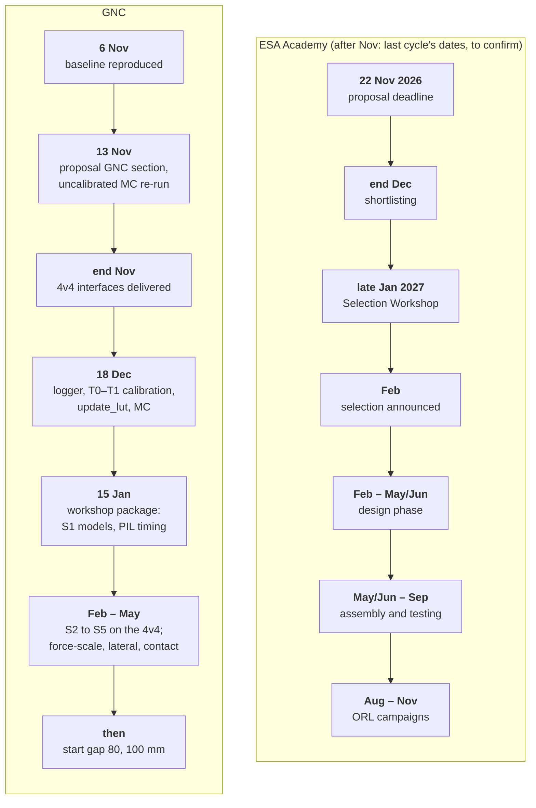

# Open points

The work and research agenda for the GNC team. It is broad on purpose: each entry is a question with a reason and a starting point, not a specification, and any of them can grow into a study, a design change or a thesis-sized topic. Assignments and progress are tracked in the issue tracker; this file holds the agenda and the timeline.

A result is accepted on evidence: `run_all_tests` passes, performance is compared with the baseline on the same fixed-seed Monte Carlo, and the trade-offs are written down in a short note in `docs/`.

## Timeline and deadlines

ESA dates after November follow the 2025–26 cycle of the ESA Academy Experiments Programme and are to be confirmed on the programme pages. Christmas falls between the calibration and the workshop package.

| When | Milestone | GNC ready by then |
| --- | --- | --- |
| 6 Nov 2026 | baseline reproduced by the whole team | `run_all_tests` passes on every machine; `ONBOARDING.md` exercises done |
| 13 Nov 2026 | GNC section of the ESA proposal drafted | architecture, Monte Carlo results (A7 re-run), hardware test plan |
| **22 Nov 2026, 23:59 CET** | **ESA Academy Experiments Programme: proposal deadline** (Orbital Robotics Lab track, to confirm) | final GNC text |
| end Nov 2026 | 4v4 interfaces delivered | ICD §6.1 rig checklist ready; logger format agreed (D3) |
| 18 Dec 2026 | first calibration | T0 and T1 done, `update_lut`, Monte Carlo with the real uncertainty (A1) |
| end Dec 2026 | ESA shortlisting | — |
| 15 Jan 2027 | workshop package frozen | calibrated Monte Carlo, S1 sensor models (B4), PIL timing (D1), ORL experiment plan (F1–F3) |
| late Jan 2027 (last cycle: 26–30 Jan) | **Experiments Selection Workshop**, if shortlisted | presentation of the package |
| Feb 2027 | selection announced; S2–S3 on the 4v4 | camera and time sync (B6), tilt, force-scale check |
| Feb – May/Jun 2027 | design phase | S4–S5, start gap 80 and 100 mm (E1–E2); B1, B2, C1, C4–C6 |
| May/Jun – Sep 2027 | assembly and testing | experiment-specific build, flight-like test runs |
| Aug – Nov 2027 | Orbital Robotics Lab campaigns | — |

## The next months

**November 2026**
- Reproduce the baseline (`run_all_tests`, `ONBOARDING.md`).
- A7: re-run the uncalibrated Monte Carlo with path-following, for the proposal.
- Draft the GNC part of the ESA proposal: objectives, architecture, simulation evidence, test plan, what the facility adds (F2).
- Agree the log format (ICD §5.2) with electronics and start the logger (D3).
- Prepare the 1v1 calibration rig and equipment (`CALIBRATION.md`, `BOM_INPUT.md` E1–E7).
- Quick fixes in simulation: B3 (gyro-bias walk convention), C4 first look (`T.y_end` in the Monte Carlo).

**December 2026**
- A1: T0 and T1 on the 1v1 rig, `update_lut`, Monte Carlo with the real uncertainty; T2 if time allows.
- D1/D2: Nucleo-H743ZI2 bring-up, PIL with execution profiling, first firmware around `gnc_step`.
- B1: measurement model of the side-looking lateral sensor.
- S1 (sensors at rest) as soon as the 4v4 float and sensors exist.

**January 2027**
- Freeze the workshop package by mid-January; rehearse the presentation.
- B4: sensor models from the S1 data fed back into `make_log` and the Monte Carlo.
- F1: first simulation of the experiment as it would run at the Orbital Robotics Lab.

**February – June 2027 (design phase)**
- Hardware stages S2–S5 on the 4v4, then start gaps 80 and 100 mm (E1, E2).
- B2 force-scale estimation, C1 time-varying LQR or another alternative, C4 lateral, C5 contact, C6 3-D effects.
- Experiment design and reviews for the facility (F1–F3).

**June – November 2027**
- Assembly and testing of the experiment configuration; Orbital Robotics Lab campaign.

## A. Force model and calibration

| # | Open point | Why it matters | Starting point | When |
| --- | --- | --- | --- | --- |
| A1 | Calibrate the force model on the 1v1 rig (T0, T1, T2) and quote the Monte Carlo with the real uncertainty | uncalibrated, the model is a factor-of-two estimate and the loop is not flyable (44% pass) | `CALIBRATION.md`, `update_lut`, `monte_carlo` | Dec 2026 |
| A2 | Near-contact physics: induced magnetisation between the cores, local saturation, hysteresis. Where does the pole model stop being valid, and does a richer model (pole + induced dipole, or a FEM force map) change the controller in the last millimetres? | all the braking happens below ~20 mm, and the model is weakest there | T2 data; FEMM axisymmetric 1v1 with the real B–H curve (T7); `asteria_wrench` | design phase |
| A3 | Coil-to-coil spread: per-coil strengths if T0 shows more than ±5% | a weaker coil turns into an unwanted yaw torque; the 1v1 fit only sees the product of two coils | T0 data; `asteria_wrench` (one `q` per coil) | after T0 |
| A4 | Electrical and dynamic effects: coil inductance in the plant, driver dynamics, eddy currents in brackets, force lag at current reversal (T5) | braking is a current reversal; a lag there acts like a delay in the fastest part of the loop | `mc_run` (current lag), T5, LCR data | design phase |
| A5 | Thermal behaviour: winding temperature rise during a run and between runs, its effect on `i_max` and on the drivers, coil temperature stop (SAF-03) | `i_max` and therefore R in the LQR depend on the hot resistance | `bench_init_3dof` (`P.coil.dT`), target current and bus voltage logs | design phase |
| A6 | Scale-up to flight coils: core saturation, when the linear pole model stops holding, magnetic cleanliness of the spacecraft | the method transfers to flight, the numbers do not (`RUNBOOK.md` §4) | scaling argument in the runbook; FEM | later |
| A7 | Re-run the uncalibrated Monte Carlo (`fs_range = [0.3 3]`) with path-following | the 44% figure predates path-following and will be quoted in the proposal | `monte_carlo` | 13 Nov 2026 |

## B. Estimation

| # | Open point | Why it matters | Starting point | When |
| --- | --- | --- | --- | --- |
| B1 | Measurement model of the side-looking lateral sensor (VL53L4CD on a rail): it also sees yaw | the current model `z = y` is a placeholder; the lateral channel is the only way to see drift during braking | `asteria_meas`, `cg_meas`, `test_ekf`, `test_sil` | Dec 2026 – Jan 2027 |
| B2 | Online force-scale estimation from the accelerometer | the remaining fast arrivals come from an actuator stronger than modelled (1.08–1.25×); in orbit there is no balance, so the force scale must be estimated in flight | BMI088 accelerometer channel already logged; `asteria_ekf` (new state), observability with the accelerometer bias | design phase |
| B3 | Gyro-bias random-walk convention: `P.gyro.sig_bw` is labelled per √s but discretised as (σ·Ts)², a variance 1000× smaller than the label implies | a bias drifting with coil heating would be tracked too slowly | `asteria_ekf_sizes`; regenerate `pc` and rerun the tests | Nov 2026 |
| B4 | Sensor models from data: ToF noise against range, angle and surface, offset and scale, latency on the data-ready line, temperature; gyro noise and bias stability (Allan variance); current-sense noise | Rd is measured, never tuned; the simulator and the Monte Carlo should use the measured sensors | stage S1, `identify_from_log(...,'rest')`, `make_log` | Jan 2027 |
| B5 | Estimator alternatives on the same replay logs: UKF, iterated EKF, moving-horizon estimation | the EKF linearisation is assumed adequate, not proven; NEES against truth decides | `replay_ekf`, logs with truth columns | design phase |
| B6 | Truth pipeline: validation camera, markers, time synchronisation with the bench clock | the only way to see sensor offsets and latency, which the filter's own tests cannot detect | ICD LOG-03, `identify_from_log(...,'latency')` | before S2 (Feb 2027) |

## C. Guidance and control

| # | Open point | Why it matters | Starting point | When |
| --- | --- | --- | --- | --- |
| C1 | Time-varying LQR along the reference (Riccati differential equation solved offline), compared with the frozen-gap schedule | the frozen-time assumption fails for the slow axial mode near contact (`ONBOARDING.md`, gain schedule); a time-varying design removes it at the same online cost | `build_schedule`, `asteria_ctrl`, Monte Carlo | design phase |
| C2 | Constraint-aware and robust control: MPC (outer loop) over the LQR, robust designs against the force-scale uncertainty, behaviour at current saturation near contact | the long-term architecture is still open; the reference now handles constraints by design, using at most half the authority | `asteria_ctrl`, `cg_ctrl`, Monte Carlo, PIL timing budget | design phase |
| C3 | Reference design: retune `alpha`, `v_cap`, `x_gate`, `path_gate`; longer start gaps with less tilt tolerance | arrival statistics and tilt tolerance trade against approach time | `optimize_maneuver`, `test_envelope`, start-gap/tilt table (`RUNBOOK.md` §5) | design phase |
| C4 | Lateral motion: drift during braking (repulsion makes the lateral direction unstable), a lateral requirement, limits on repulsive current near contact; canted coils (rank 3, but the third singular value is ~250× smaller at 8°; a canted interface mates only at 0° and 180° roll) | the Monte Carlo does not score lateral offset; lateral control is a system-level decision | `T.y_end` in `mc_results.mat`, cant sweep in `bench_init_3dof` §5 | Nov 2026 (check), design phase (decision) |
| C5 | Contact dynamics: impact, rebound, settling after x = 0; what arrival velocity a latch needs | every run stops at contact today; the arrival requirement has no model behind it | `asteria_plant` (contact model), T2 data, capture mechanism concept | design phase |
| C6 | Out-of-plane effects: interfaces not parallel (roll, pitch), height offset, a 6-DoF model; Earth's field torque | the model is planar; in orbit all six degrees of freedom are free | `asteria_wrench` (3-D poles already), new plant | design phase |

## D. Embedded software and test infrastructure

| # | Open point | Why it matters | Starting point | When |
| --- | --- | --- | --- | --- |
| D1 | Processor-in-the-loop on the Nucleo-H743ZI2: outputs within 1e-9 of MATLAB, worst-case `gnc_step` under 500 µs, tick jitter | proves the processor choice before the carrier PCB | `RUNBOOK.md` §8, `build_target`, `test_sil_lib`, STM32 support package | Dec 2026 – Jan 2027 |
| D2 | Firmware around `gnc_step`: scheduler, drivers, gyro decimation to 2 ms (or re-verification at 1 ms), abort chain | the GNC is verified only with the timing and interfaces of the ICD | `ICD.md` §4–5 | Dec 2026 – Feb 2027 |
| D3 | Logger and CSV converter to the ICD record format; target-side logger and time synchronisation | nothing can be replayed or identified without full-rate logs | `ICD.md` §5.2, `replay_ekf` | Dec 2026 |
| D4 | Host SIL of the generated library | the exact C has been checked only through MEX so far | `build_target`, `test_sil_lib` (full Xcode on macOS) | Dec 2026 |
| D5 | Continuous integration: `run_all_tests` on every push | keeps the baseline reproducible as the code changes | MathWorks GitHub actions (check licensing for the repository) | when convenient |
| D6 | Single-precision arithmetic, should a smaller processor ever be needed | `test_precision` covers storage only | arithmetic analysis, single-precision SIL | later |

## E. Hardware campaign

| # | Open point | Why it matters | Starting point | When |
| --- | --- | --- | --- | --- |
| E1 | Stages S1–S5 on the 4v4, each owning and freezing its parameters | the acceptance path from simulation to hardware | `RUNBOOK.md` §5–6, `TOOLCHAIN.md` | Dec 2026 – May 2027 |
| E2 | Start gap 80 mm, then 100 mm, after each previous gap passes | authority falls with the gap and the tilt tolerance with it | start-gap/tilt table, table levelling | spring 2027 |
| E3 | Table tilt map instead of a single tilt value | a non-uniform table shows as a tilt estimate drifting with position | `identify_from_log(...,'drift')` at several start gaps | with S2 |
| E4 | Model checks beyond the 1v1: lateral stiffness (T3), superposition (T4), in-situ identification at a standoff (T6) | the 4v4 field is predicted from the 1v1 calibration, not measured | `RUNBOOK.md` §4 campaign table | design phase |

## F. ESA Academy and the Orbital Robotics Lab

| # | Open point | Why it matters | Starting point | When |
| --- | --- | --- | --- | --- |
| F1 | The experiment as it would run on the facility's air-bearing platform (MANTIS): masses, sensors, start gaps, two floating bodies or one, magnetic environment, run time available | the bench results transfer only as far as the configurations match; simulate the facility case before proposing numbers | facility documentation, `bench_init_3dof` with the facility parameters | proposal (Nov 2026) and Jan 2027 |
| F2 | Objectives and success criteria: what the UniPD bench demonstrates, what only the facility can add | the proposal and the selection workshop are judged on this | bench results, Monte Carlo, hardware stages | Nov 2026 |
| F3 | Predictions before the campaign and their comparison afterwards: what is logged, which numbers are predicted, how agreement is judged | a campaign without prior predictions cannot validate the model | `make_log`, `replay_ekf`, Monte Carlo | design phase |
